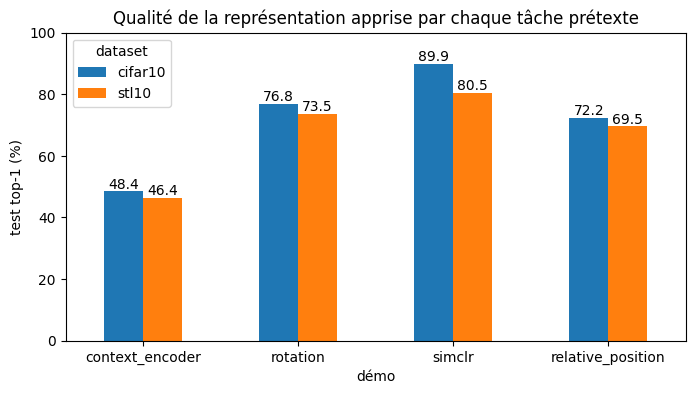

# TP : apprentissage de représentations par des approches auto-supervisées

TP Image du M2 Informatique, parcours VMI, Université Paris Cité.
Auteur : Lucka Harena. Compte rendu : [`TP_ssl.pdf`](TP_ssl.pdf).

Le TP repose sur les démos du cours CS294-158 (UC Berkeley), reprises dans le dépôt
[ckurtz/cs294-158-ssl](https://github.com/ckurtz/cs294-158-ssl). Ce dépôt contient :

- l'exécution des trois démos : *context encoder*, prédiction de rotation, SimCLR (consignes 1 et 2) ;
- un script qui compare les représentations sur CIFAR-10 et STL-10 (consignes 3 et 4) ;
- l'implémentation d'une nouvelle tâche prétexte, la position relative de patchs
  (Doersch *et al.*, 2015), et son évaluation (consignes 5 et 6).

## Contenu

| Fichier | Rôle |
|---|---|
| `TP_Self_Supervised.ipynb` | Le notebook complet exécuté sur Colab, avec ses sorties |
| `src/comparaison_ssl.py` | Évaluation linéaire des représentations et tableau comparatif (consignes 3, 4 et 6) |
| `src/position_relative.py` | Tâche prétexte de position relative et son entraînement (consigne 5) |
| `resultats/comparaison.csv` | Tableau des résultats |
| `resultats/comparaison.png` | Graphique des résultats |
| `TP_ssl.pdf` | Compte rendu du TP |

Les fichiers de `src/` reprennent le code des cellules correspondantes du notebook.

## Exécution

Le plus simple est d'ouvrir le notebook dans Google Colab avec un GPU
(*Exécution → Modifier le type d'exécution → GPU*) et d'exécuter les cellules dans l'ordre :

1. installation : clonage de `cs294-158-ssl`, téléchargement de `data.zip` (3,9 Go) et `results.zip` (2,5 Go, les modèles pré-entraînés des démos) ;
2. démos 1 à 3 : évaluation linéaire et plus proches voisins de chaque modèle ;
3. comparaison sur CIFAR-10 et STL-10 (STL-10 est téléchargé depuis Hugging Face, `tanganke/stl10`) ;
4. entraînement de la position relative (200 époques), puis comparaison des quatre méthodes.

Pour utiliser les scripts hors du notebook, il faut se placer dans le dossier `cs294-158-ssl`
après l'installation, puis lancer :

```bash
python /chemin/vers/src/position_relative.py      # entraîne la tâche, écrit position_relative.pth
python /chemin/vers/src/comparaison_ssl.py        # écrit comparaison.csv et comparaison.png
```

Dépendances : PyTorch, torchvision, pandas, matplotlib, `datasets` (Hugging Face) et la
librairie `deepul_helper` installée depuis `cs294-158-ssl`.

## Protocole

- Chaque encodeur est pré-entraîné sur CIFAR-10 **sans étiquettes**, puis figé.
- Une couche linéaire est entraînée au-dessus, avec le même classifieur que dans chaque démo :
  représentations calculées une fois (10 000 images au maximum), 30 époques, Adam (lr = 10⁻³), lots de 256.
- STL-10 (images 96 × 96 réduites à 32 × 32) sert de second jeu de données. Il n'a que
  5 000 images annotées pour l'entraînement.
- La position relative utilise le même encodeur que la rotation (*Network in Network*, couche `conv2`) :
  grille 3 × 3 de cellules de 10 pixels, patchs de 8 × 8, décalage aléatoire de ±1 pixel,
  passage en gris avec une probabilité de 0,66, puis recalcul des statistiques de BatchNorm
  sur des images entières.

## Résultats

Précision en test (%) de la classification linéaire sur la représentation figée.
Tous les classifieurs sont réentraînés avec le même protocole.

| Tâche prétexte | CIFAR-10 top-1 | CIFAR-10 top-5 | STL-10 top-1 | STL-10 top-5 |
|---|---|---|---|---|
| *Context encoder* | 48,4 | 92,0 | 46,4 | 91,4 |
| Rotation | 76,8 | 98,3 | 73,5 | 98,1 |
| SimCLR | **89,9** | **99,7** | **80,5** | **99,0** |
| Position relative | 72,2 | 97,5 | 69,5 | 97,8 |



Sur la tâche prétexte elle-même, la position relative atteint 60,4 % de bonnes réponses
après 200 époques (12,5 % au hasard).

## Références

- D. Pathak *et al.* *Context encoders: Feature learning by inpainting*. CVPR, 2016.
- S. Gidaris, P. Singh, N. Komodakis. *Unsupervised representation learning by predicting image rotations*. ICLR, 2018.
- T. Chen *et al.* *A simple framework for contrastive learning of visual representations*. ICML, 2020.
- C. Doersch, A. Gupta, A. Efros. *Unsupervised visual representation learning by context prediction*. ICCV, 2015.
- A. Coates, A. Ng, H. Lee. *An analysis of single-layer networks in unsupervised feature learning*. AISTATS, 2011.
- Cours CS294-158 Deep Unsupervised Learning, UC Berkeley, 2020.
